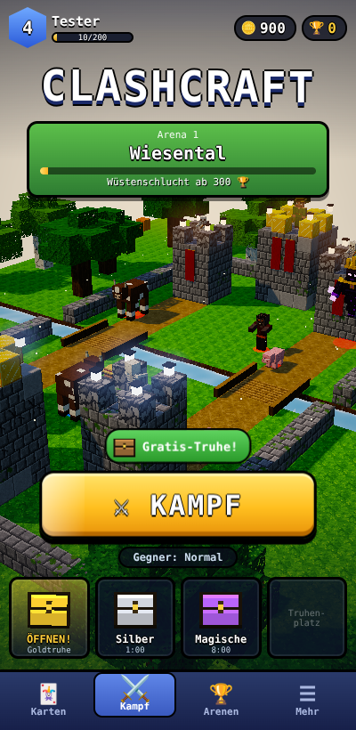
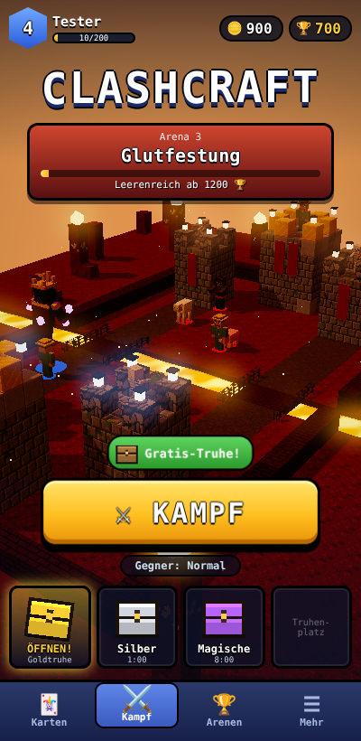
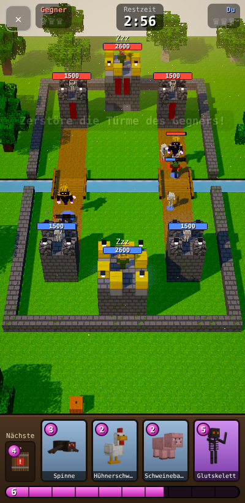
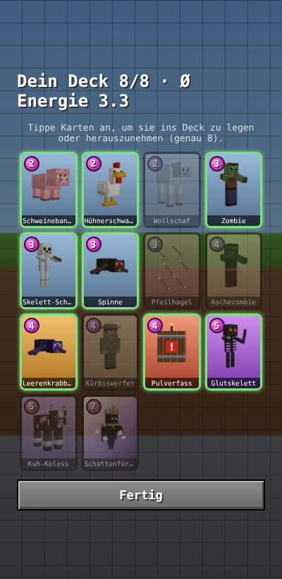
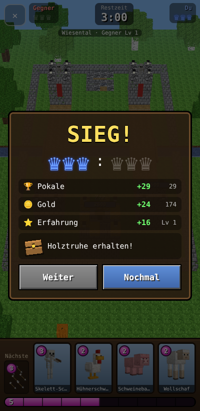
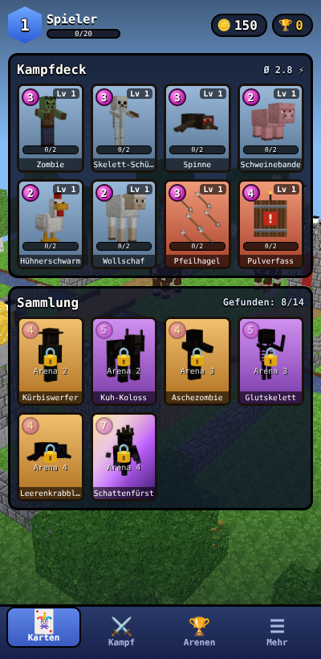
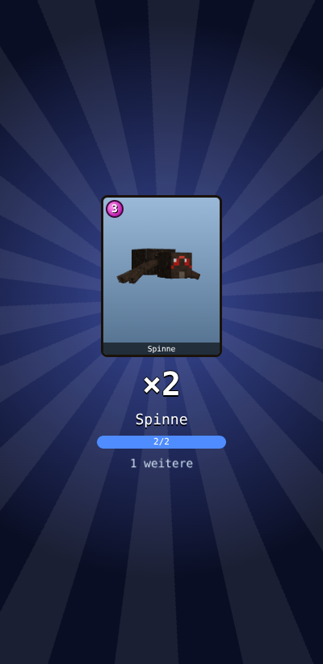
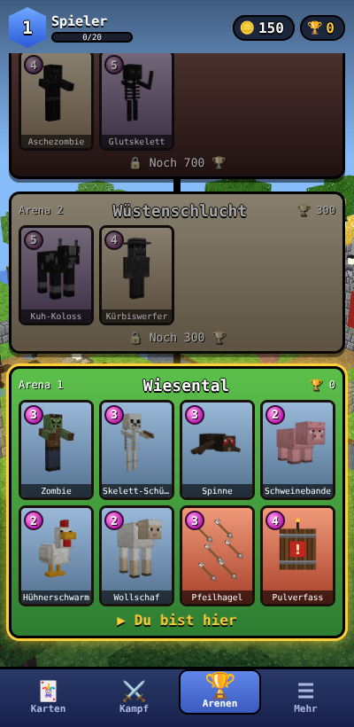
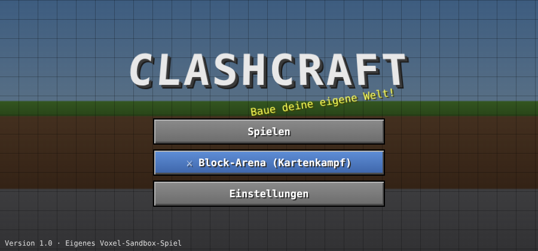

<div align="center">

# ⚔️ ClashCraft

**Ein 3D-Kartenkampf in einer Blockwelt – plus ein komplettes Voxel-Sandbox-Spiel. Für Android.**

[](apk/ClashCraft.apk)
[](../../actions)

 

</div>

---

## 📲 Installieren

1. Auf dem Handy **[`apk/ClashCraft.apk`](apk/ClashCraft.apk)** öffnen → **„Download raw file“**
   (oder unter **Releases** die neueste `ClashCraft.apk` laden).
2. Datei öffnen und installieren. Beim ersten Mal „Apps aus unbekannten Quellen installieren“ erlauben.
3. Im Hauptmenü **⚔ Block-Arena** antippen – los geht's!

> Die App läuft im **Hochformat** (Arena und Menüs). Nur die Blockwelt-Sandbox dreht sich automatisch ins Querformat.
>
> Benötigt Android 8 oder neuer. Die APK wird bei jedem Push automatisch von GitHub Actions neu gebaut.

---

## ⚔️ Block-Arena – der Kartenkampf

Zwei Spieler, zwei Bahnen, ein Fluss mit Brücken – und auf jeder Seite drei Türme.
Spiele Mob-Karten aus, verteidige deine Türme und zerstöre die des Gegners!

<table>
<tr>
<td width="33%"></td>
<td width="33%"></td>
<td width="33%"></td>
</tr>
<tr>
<td align="center">Kampf im Hochformat</td>
<td align="center">Deck-Editor</td>
<td align="center">Sieg!</td>
</tr>
</table>

### So wird gespielt
- **Energie** 🟣 lädt sich langsam auf (max. 10). Jede Karte kostet Energie.
- **Karte aufs Feld ziehen** – oder Karte antippen und dann aufs Feld tippen. Rote Bereiche sind gesperrt.
- Mobs laufen selbstständig über die Brücken und greifen an, was ihnen in den Weg kommt.
- Jeder zerstörte Wachturm bringt eine **Krone** 👑 – und du darfst auf dieser Seite weiter vorne ausspielen.
- Fällt der **Königsturm**, ist das Spiel sofort gewonnen (3 Kronen).
- Ein Match dauert **3 Minuten**, in der letzten Minute gibt es **2× Energie**.
  Bei Gleichstand folgt eine **Verlängerung**: Der nächste Turm entscheidet.
- Siege bringen **🏆 Pokale**, der Computergegner hat 3 Stufen (Leicht / Normal / Schwer).

### Fortschritt – ein richtiges Spiel
- **Startseite** mit animierter 3D-Arena im Hintergrund, Spieler-Level, Gold, Pokalen und Tab-Leiste
  (🃏 Karten · ⚔️ Kampf · 🏆 Arenen · ☰ Mehr)
- **Truhen** 🧰: Jeder Sieg bringt eine Truhe (Holz, Silber, Gold, Magisch). Truhe antippen → Timer läuft →
  öffnen mit Animation: Gold und Karten fliegen heraus. Alle 2 Stunden gibt es eine **Gratis-Truhe**.
- **Karten aufwerten** ⬆️: Sammle Kartenkopien + Gold, um Karten zu leveln (bis Level 9, +10 % Leben & Schaden pro Level).
  Aufwerten gibt Erfahrung → **Spieler-Level** → stärkere Türme.
- **4 Arenen** auf dem Pokalpfad, jede mit eigenem Look und neuen Karten:

| Arena | Pokale | Look | Neue Karten |
|---|:-:|---|---|
| 1 · Wiesental | 0 | Gras, Bäume, Fluss | Startkarten |
| 2 · Wüstenschlucht | 300 | Sand, Kakteen, Sandstein | Kuh-Koloss, Kürbiswerfer |
| 3 · Glutfestung | 700 | Glutgestein, **Lavafluss**, glühende Kristalle | Aschezombie, Glutskelett |
| 4 · Leerenreich | 1200 | Sternenhimmel, Obsidian-Säulen, Leerenfluss | Leerenkrabbler, **Schattenfürst** |

- Der Computergegner wird mit deinen Pokalen stärker (höhere Kartenlevel).
- Kampf-Animationen: Countdown 3-2-1-LOS, Karten fliegen aufs Feld, Mobs fallen beim Besiegen um,
  gegnerische Karten werden angezeigt, Kronen ploppen auf, Belohnungsbildschirm nach dem Kampf.

<table><tr>
<td></td><td></td><td></td>
</tr><tr><td align="center">Karten &amp; Deck</td><td align="center">Truhe öffnen</td><td align="center">Pokalpfad</td></tr></table>

### Die Karten

| Karte | ⚡ | Beschreibung |
|---|:-:|---|
| 🐔 Hühnerschwarm | 2 | Vier fliegende Hühner – Nahkämpfer erreichen sie nicht |
| 🐷 Schweinebande | 2 | Drei Schweine, die gemeinsam drauflos rennen |
| 🐑 Wollschaf | 2 | Billiger, flauschiger Schutzschild |
| 🧟 Zombie | 3 | Robuster Nahkämpfer |
| 💀 Skelett-Schützen | 3 | Zwei Bogenschützen, treffen auch Flieger |
| 🕷️ Spinne | 3 | Sehr schnell und bissig |
| 🏹 Pfeilhagel | 3 | Zauber: Pfeilregen auf ein großes Gebiet |
| 🔥 Aschezombie | 4 | Zäher Brocken aus der Unterwelt |
| 🟣 Leerenkrabbler | 4 | Rennt direkt zu den Türmen |
| 🎃 Kürbiswerfer | 4 | Dorfbewohner, der Kürbisse mit Flächenschaden wirft |
| 🛢️ Pulverfass | 4 | Zauber: große Explosion im Zielgebiet |
| ⚔️ Glutskelett | 5 | Langsame, aber vernichtende Klingenhiebe |
| 🐄 Kuh-Koloss | 5 | Riesiger Panzer, greift nur Gebäude an |
| 👑 **Schattenfürst** | 7 | **Legendär!** Schwebender Obsidian-König, schleudert explodierende Seelenkugeln |

### Grafik
Alle Blöcke haben einen klassischen, knackigen **16×16-Pixel-Look** (Gras, Erde, Stein, Bruchstein, Holzbretter,
Stämme, Laub, Steinziegel, Sand …) – komplett im Code gemalt.
Mit eingeschalteten Shadern (Einstellungen → *Shader* / *Shader-Effekte*):
weiche Sonnenschatten, Abendsonnen-Licht, Himmel mit Sonne, animiertes Wasser mit Spiegelung und Gischt,
Leuchten (Bloom), Lichtstrahlen, Laternen auf den Türmen und schwebende Lichtfunken.
Auf schwächeren Handys einfach die Shader ausschalten.

---

## 🧱 Blockwelt – die Sandbox



Unter **Spielen** steckt ein komplettes Voxel-Sandbox-Spiel (Abbauen, Bauen, Craften, Überleben):

- Unendliche, zufällige Welt: Ebenen, Wälder, Taiga, Wüsten, Schnee, Berge, Sümpfe, Dschungel, Ozeane
- Höhlen, Erze, 85 Blöcke und über 100 Items, Werkzeuge & Rüstungen in mehreren Stufen
- Crafting, Ofen, Truhen, Bett, Ackerbau, Wasser- und Lavafluss
- Überlebens- und Kreativmodus, Tag-/Nacht-Zyklus
- Tiere, Monster und Dorfbewohner
- Dörfer, Tempel, Untergrundfestung, **Unterwelt** und **Leere** mit eigenen Bauwerken
- Mehrere Welten, automatisches Speichern, Touch-Steuerung

---

## 🛠️ Selbst bauen

```bash
npm install
npm run build            # erzeugt android/app/src/main/assets/www/game.js
cd android && ./gradlew assembleRelease
# -> android/app/build/outputs/apk/release/app-release.apk
```

Zum Testen im Browser: `android/app/src/main/assets/www/` mit einem lokalen Webserver öffnen
(z. B. `python3 -m http.server`) und `index.html` aufrufen.

**Steuerung am PC:** Block-Arena mit der Maus (Karten ziehen oder anklicken).
Sandbox: WASD laufen · Maus umsehen · Linksklick abbauen · Rechtsklick platzieren · Leertaste springen · E Inventar · 1–9 Hotbar.

### Projektaufbau
| Datei | Inhalt |
|---|---|
| `src/arena.js` | Block-Arena: Spielfeld, Einheiten, Türme, Computergegner, Shader |
| `src/cards.js` | Alle Karten mit ihren Werten, Deck & Pokale |
| `src/models.js` | Mob-Modelle (inkl. Schattenfürst) |
| `src/textures.js` | Prozedural gemalte Pixel-Texturen |
| `src/game.js`, `src/world*.js` … | Sandbox-Spiel |
| `.github/workflows/android.yml` | Baut die APK und legt sie unter `apk/` + Releases ab |

---

## 📜 Hinweis

ClashCraft ist ein eigenes Fan-Projekt. **Alle Texturen, Modelle und Sounds werden im Code selbst erzeugt** –
es werden keine Grafiken, Sounds oder Figuren aus anderen Spielen verwendet.
